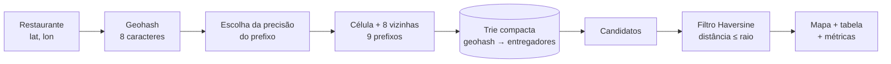
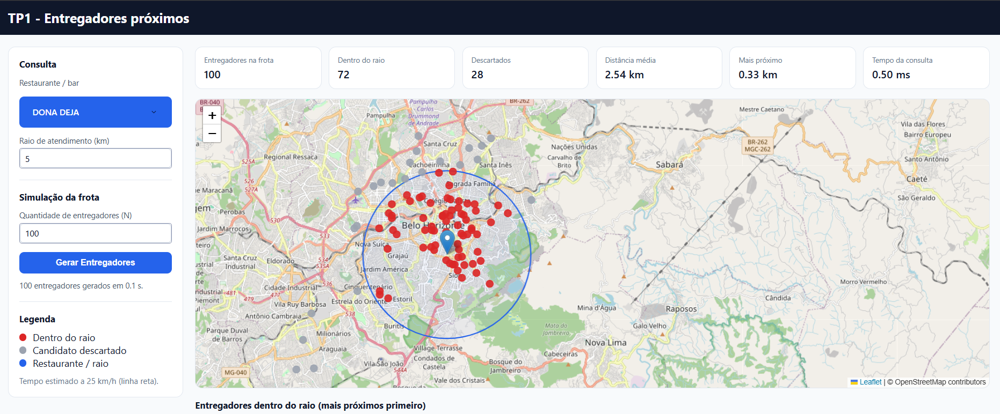
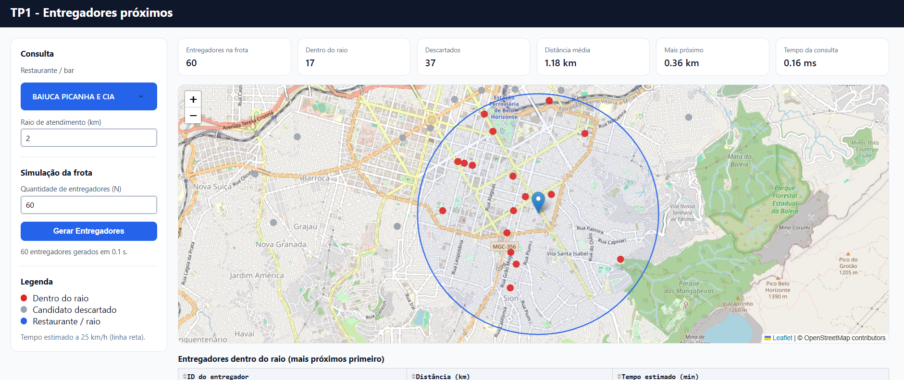
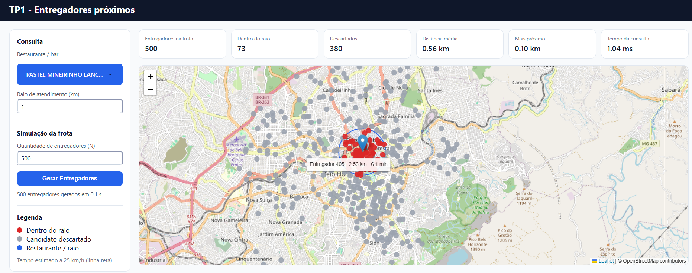

# Relatório – TP1: Indexação Geoespacial e Geometria Computacional Híbrida

**Disciplina:** DCC207 – Algoritmos 2 · DCC/ICEx/UFMG
**Professor:** Renato Vimieiro
**Autor** Thales Faria Almeida - 2024013974
**Repositório:** https://github.com/thales05faria/tp1-alg2

---

## 1. Introdução

Aplicativos de entrega precisam responder, em tempo real, a uma pergunta simples: *quais entregadores estão perto deste restaurante?* A solução ingênua compara o restaurante com todos os $N$ entregadores da frota, custando $O(N)$ por consulta. Quando a frota é grande e as consultas são frequentes, isso é desperdício, porque a maior parte dos entregadores está longe e poderia ser descartada sem nem ser examinada.

Este trabalho implementa um motor de busca e monitoramento geoespacial **híbrido** para uma frota de entregadores em Belo Horizonte. Ele combina duas ideias:

1. **Indexação por prefixo:** cada posição é convertida em um *Geohash* (string Base32 de 8 caracteres) e armazenada em uma **Trie compacta**. Posições próximas compartilham prefixos, então uma busca por prefixo recupera rapidamente uma região da cidade.
2. **Geometria computacional:** os candidatos recuperados passam por uma filtragem exata, com a distância de Haversine, para ficar apenas com os que estão dentro do raio de atendimento.

O sistema oferece uma interface web interativa (mapa, tabela e métricas) e um gerador de dados sintéticos, que posiciona os entregadores com uma distribuição normal em torno dos bares e corrige as posições para ruas reais do OpenStreetMap.

### Contribuições

- Implementação própria do Geohash (codificação, decodificação e vizinhança).
- Implementação própria de uma Trie compacta (árvore radix) com busca por prefixo em $O(m + k)$.
- Tratamento do problema de borda do Geohash por meio de busca nas células adjacentes.
- Gerador de frota sintética com distribuição normal e restrição viária.
- Interface interativa e experimentos comparando a busca por Trie com a força bruta.

---

## 2. Visão geral da arquitetura



| Módulo | Responsabilidade |
|---|---|
| `entregadores/geohash.py` | `encode`, `decode`, `vizinhos`, `escolher_precisao` |
| `entregadores/trie.py` | Trie compacta: `inserir`, `buscar_prefixo` |
| `entregadores/busca.py` | Consulta completa e medição do tempo |
| `entregadores/geometria.py` | Distância de Haversine e tempo estimado |
| `entregadores/gerador.py` | Posições sintéticas e projeção na malha viária |
| `entregadores/dados.py` | Leitura do CSV de bares |
| `scripts/geocodificar.py` | Converte endereços do CSV original em coordenadas |
| `scripts/benchmark.py` | Compara Trie × força bruta |
| `app.py`, `assets/style.css` | Interface (Dash + Leaflet) |
| `tests/test_core.py` | Testes das estruturas e da busca |

---

## 3. Implementação

### 3.1 Geohash

O Geohash divide o globo recursivamente em células retangulares. Para codificar uma coordenada:

1. Mantêm-se dois intervalos: longitude em $[-180, 180]$ e latitude em $[-90, 90]$.
2. A cada passo, alternando entre longitude (primeiro) e latitude, calcula-se o ponto médio do intervalo. Se a coordenada está na metade superior, emite-se o bit `1` e o limite inferior passa a ser o ponto médio. Caso contrário, emite-se `0` e o limite superior passa a ser o ponto médio.
3. Os bits são agrupados de 5 em 5, e cada grupo vira um caractere do alfabeto Base32 do Geohash (`0123456789bcdefghjkmnpqrstuvwxyz`).

Com **8 caracteres** são 40 bits, 20 de longitude e 20 de latitude. Em Belo Horizonte (latitude ≈ −20°), a célula resultante mede aproximadamente **36 m × 19 m**.

A implementação foi validada com o valor de referência conhecido `encode(57.64911, 10.40744) = "u4pruydq"` (oito primeiros caracteres de `u4pruydqqvj`).

**Propriedade usada pelo sistema:** se dois Geohashes compartilham um prefixo de $p$ caracteres, os pontos estão na mesma célula de precisão $p$. O prefixo identifica, portanto, uma região da cidade, e é isso que permite indexar por prefixo.

Tamanho aproximado das células em Belo Horizonte:

| Precisão $p$ | Altura (lat.) | Largura (lon.) | Menor lado |
|:-:|:-:|:-:|:-:|
| 4 | ≈ 19,6 km | ≈ 36,8 km | ≈ 19,6 km |
| 5 | ≈ 4,9 km | ≈ 4,6 km | ≈ 4,6 km |
| 6 | ≈ 0,61 km | ≈ 1,15 km | ≈ 0,61 km |
| 7 | ≈ 0,15 km | ≈ 0,14 km | ≈ 0,15 km |
| 8 | ≈ 19 m | ≈ 36 m | ≈ 19 m |

### 3.2 Trie compacta

Uma trie comum guardaria um nó por caractere de cada chave. Como todas as chaves têm 8 caracteres e muitas compartilham longos prefixos, uma trie simples teria muitos nós com um único filho. A **trie compacta** (árvore radix ou PATRICIA) resolve isso fundindo cadeias de nós com um único filho em uma única aresta rotulada com uma *string*.

**Estrutura do nó**

| Campo | Descrição |
|---|---|
| `rotulo` | String da aresta que chega ao nó (vazia na raiz) |
| `filhos` | Dicionário `primeiro caractere do rótulo → nó filho` |
| `valores` | Lista de ids de entregadores cujo Geohash termina neste nó |

Os filhos são indexados pelo **primeiro caractere** do rótulo. Como as arestas que saem de um mesmo nó começam sempre por caracteres distintos, esse caractere basta para escolher a aresta em $O(1)$. A lista `valores` permite que **vários entregadores no mesmo Geohash** (mesma célula de 8 caracteres) sejam armazenados no mesmo nó.

Exemplo com as chaves `7h2y8abc`, `7h2y8abd` e `7h2y9xyz`:

```
raiz
 └── "7h2y"
      ├── "8ab"
      │     ├── "c"   → [entregadores com 7h2y8abc]
      │     └── "d"   → [entregadores com 7h2y8abd]
      └── "9xyz"      → [entregadores com 7h2y9xyz]
```

**Inserção.** Percorre-se a árvore casando a chave com os rótulos das arestas:

1. Se não existe aresta começando pelo próximo caractere, cria-se um nó folha com o restante da chave.
2. Se existe, calcula-se o prefixo comum entre o rótulo e o restante da chave:
   - se o rótulo inteiro casa, desce-se ao filho e continua-se;
   - se casa só em parte, a aresta é **dividida** (*split*). Cria-se um nó intermediário com o prefixo comum e o filho antigo passa a ser filho desse nó, com o rótulo restante.
3. Ao esgotar a chave, o valor é anexado à lista `valores` do nó atual.

Como as chaves têm tamanho fixo (8), a inserção custa $O(1)$ em relação a $N$.

**Busca por prefixo.** Percorre-se a árvore consumindo o prefixo:

1. A cada passo, escolhe-se a aresta pelo primeiro caractere restante do prefixo. Se ela não existe, o resultado é vazio.
2. Compara-se o rótulo da aresta com o trecho correspondente do prefixo. Se divergem, o resultado é vazio.
3. Se o prefixo termina no **meio** de uma aresta, tudo o que está abaixo dela casa com o prefixo, e a busca prossegue normalmente a partir do nó de destino.
4. Chegando ao nó em que o prefixo se esgota, coleta-se toda a subárvore (com uma pilha, sem recursão).

**Complexidade.** A descida custa $O(m)$, em que $m$ é o tamanho do prefixo. Na coleta, a subárvore tem $O(k)$ nós, sendo $k$ o número de entregadores retornados. Isso vale porque, na trie compacta, todo nó interno sem valor tem pelo menos dois filhos. Uma árvore com $k$ folhas e essa propriedade tem no máximo $2k - 1$ nós. A busca custa então **$O(m + k)$**, como pedido no enunciado.

O espaço total é $O(N)$: no máximo cerca de $2N$ nós.

### 3.3 O problema de borda e a busca nas células vizinhas

Dois pontos muito próximos podem ter Geohashes com prefixos diferentes se estiverem em lados opostos de uma divisão da grade. Buscar apenas o prefixo da célula do restaurante perderia entregadores que estão a poucos metros, mas do outro lado da linha.

**Solução adotada:**

1. Escolhe-se a **maior precisão $p$** cuja célula ainda tem, nas duas direções, lado maior ou igual ao raio de atendimento $r$ (função `escolher_precisao`).
2. Calcula-se o prefixo do restaurante com $p$ caracteres e, a partir do centro e do tamanho dessa célula, o prefixo das **8 células adjacentes** (`vizinhos`), tratando os limites de latitude e a volta de longitude.
3. Executa-se uma busca na Trie para cada um dos (até) 9 prefixos.

**Por que isso cobre todo o círculo.** O restaurante está dentro da célula central. Qualquer ponto a até $r$ de distância está, em cada eixo, a no máximo $r$ do restaurante. Como cada célula tem lado maior ou igual a $r$, esse ponto não pode estar além da célula vizinha mais próxima naquele eixo. Logo, todo ponto do círculo pertence ao bloco $3 \times 3$ formado pela célula central e suas vizinhas. Nenhum entregador dentro do raio é perdido, e o que a Trie devolve é um **superconjunto** do resultado correto.

Para $r = 2$ km, por exemplo, a precisão escolhida é $p = 5$ (células de ≈ 4,9 km × 4,6 km). Para raios entre ≈ 0,15 km e 0,61 km, $p = 6$, e assim por diante.

O custo da busca passa a ser $O(9m + K)$, em que $K$ é o número de candidatos retornados.

### 3.4 Filtragem geométrica

Os $K$ candidatos formam um bloco retangular, que contém o círculo de busca mas é maior que ele. A filtragem final usa a **distância de Haversine**, que calcula a distância sobre a superfície esférica da Terra ($R \approx 6371$ km):

$$
d = 2R \cdot \arcsin\sqrt{\sin^2\!\frac{\Delta\varphi}{2} + \cos\varphi_1\cos\varphi_2\sin^2\!\frac{\Delta\lambda}{2}}
$$

Os candidatos com $d \le r$ são **destacados** (pino vermelho). Os demais candidatos, descartados pelo filtro, aparecem em cinza. A lista dos entregadores dentro do raio é ordenada por distância (custo $O(k' \log k')$, com $k'$ o número de entregadores aceitos).

**Tempo de chegada estimado:** $t = d / v \cdot 60$ minutos, com velocidade média $v = 25$ km/h. Trata-se de uma estimativa simples, em linha reta, que não considera o trajeto real nas ruas nem o trânsito.

**Custo total de uma consulta:** $O(1)$ para codificar o restaurante, $O(9m + K)$ para a busca na Trie, $O(K)$ para o filtro e $O(k'\log k')$ para a ordenação. Para $K \ll N$, isso é muito menor que o $O(N)$ da força bruta.

### 3.5 Base de bares

O CSV fornecido contém apenas **endereços** (`DESC_LOGRADOURO`, `NOME_LOGRADOURO`, `NUMERO_IMOVEL`, `NOME_BAIRRO`, `NOME_FANTASIA`, entre outras colunas), sem coordenadas. O script `scripts/geocodificar.py` converte esses endereços em latitude e longitude usando o serviço **Nominatim** do OpenStreetMap:

- A consulta é montada com tipo e nome do logradouro, número, bairro e "Belo Horizonte, Minas Gerais, Brasil". Se não houver resultado com número, tenta-se só a rua e o bairro.
- O nome do bar é `NOME_FANTASIA` ou, se vazio, `NOME`.
- Resultados fora de uma caixa que envolve Belo Horizonte são descartados, assim como duplicados.
- Como o Nominatim limita as requisições a cerca de uma por segundo, usa-se um **cache** local (`geocache.json`), que permite retomar o processo e evita repetir consultas.
- Foram utilizados 60 bares.

### 3.6 Gerador de entregadores sintéticos

O gerador é acionado pelo botão **Gerar Entregadores**. Ao clicar, a frota e a Trie anteriores são descartadas e uma nova frota de $N$ entregadores é criada.

**Distribuição espacial baseada em demanda.** Os $N$ entregadores são divididos igualmente entre os $B$ bares (cada bar recebe $\lfloor N/B \rfloor$, e os $N \bmod B$ restantes são distribuídos um a um aos primeiros bares). Em torno de cada bar, as posições seguem uma **distribuição normal bivariada** com desvio padrão $\sigma = 500$ m em cada eixo, com os deslocamentos convertidos de metros para graus:

$$
\Delta\varphi = \frac{\mathcal{N}(0,\sigma)}{111\,320}, \qquad
\Delta\lambda = \frac{\mathcal{N}(0,\sigma)}{111\,320\cos\varphi}
$$

Isso produz alta densidade de entregadores junto aos bares, com queda gradual à medida que a distância cresce, simulando a ociosidade da frota à espera de pedidos.

**Restrição viária.** Pontos sorteados por uma normal acabam em quarteirões fechados, edifícios ou na lagoa da Pampulha. Para corrigir isso, usa-se o grafo viário (`network_type="drive"`) do OpenStreetMap, obtido com o **osmnx**:

1. O grafo da região que envolve todos os bares (com uma margem de 0,02°, ≈ 2 km) é baixado uma única vez e guardado em cache em disco.
2. Cada ponto sorteado é movido para o **nó do grafo mais próximo** (`nearest_nodes`), de modo que todo entregador fica sobre uma via transitável.

**Limitação conhecida:** como os pontos são movidos para nós (cruzamentos e extremidades de vias), e não para pontos quaisquer das arestas, vários entregadores podem ser mapeados para o mesmo nó e aparecer empilhados no mapa. Uma melhoria natural seria projetar o ponto na aresta mais próxima. Esse empilhamento não afeta a correção da busca, pois a Trie armazena várias ocorrências do mesmo Geohash.

Se o grafo não puder ser baixado (por falta de internet, por exemplo), a frota é gerada **sem** correção viária e a interface avisa o usuário.

### 3.7 Interface

A interface foi construída com **Dash** e **dash-leaflet** (mapa baseado em tiles do OpenStreetMap). Ela é composta por:

- **Painel de consulta:** seleção do restaurante (lista pesquisável pelo nome) e campo do raio de atendimento, em km.
- **Painel de simulação:** campo com o número de entregadores $N$ e o botão **Gerar Entregadores**, com indicador de carregamento e mensagem de resultado.
- **Mapa:** restaurante, círculo com o raio de atendimento, entregadores dentro do raio em vermelho e candidatos descartados em cinza. Cada marcador mostra, ao passar o mouse, o id, a distância e o tempo estimado. O mapa centraliza e ajusta o zoom conforme o raio.
- **Métricas resumo:** entregadores dentro do raio, descartados, distância média, entregador mais próximo e tempo da consulta.
- **Tabela:** id do entregador, distância (km) e tempo estimado (min), ordenada por distância, com paginação e ordenação por coluna.

O mapa, a tabela e as métricas são atualizados automaticamente a cada mudança de restaurante, de raio ou de frota.

---

## 4. Experimentos

### 4.1 Ambiente

| Item | Valor |
|---|---|
| Sistema operacional | Ubuntu 24.04 (WSL2) |
| Python | 3.12 |
| Bares utilizados | 60 |
| Desvio padrão $\sigma$ | 500 m |
| Velocidade média | 25 km/h |

O tempo de cada consulta é medido com `time.perf_counter()` dentro do código de busca. Ele inclui a codificação do restaurante, as buscas na Trie, o cálculo das distâncias e a ordenação, e **não** inclui a renderização do mapa no navegador.

### 4.2 Consultas na interface

Para cada consulta abaixo, foram registrados o resultado e o tempo. Os prints mostram o mapa, as métricas e a tabela.

**Consulta 1 – DONA DEJA, raio 5 km, $N = $ 100**



**Consulta 2 – BAIUCA PICANHA E CIA, raio 2 km, $N = $ 60**



**Consulta 3 – PASTEL MINEIRINHO E LANCHE LTDA, raio 1 km, $N = $ 500**




### 4.3 Verificação de corretude

O arquivo `tests/test_core.py` valida:

- o Geohash contra o valor de referência `u4pruydq`;
- a decodificação (o centro da célula fica próximo do ponto original);
- que `vizinhos` devolve 8 células distintas da célula original;
- a Trie, com prefixos de vários tamanhos, chaves repetidas e prefixos inexistentes;
- que a busca completa (Geohash + Trie + vizinhas + Haversine) devolve **exatamente o mesmo conjunto** da busca por força bruta, em 50 consultas aleatórias com raios entre 0,3 e 6 km.

Esse último teste confirma, na prática, o argumento da seção 3.3 de que o tratamento de borda não perde entregadores.

```bash
python -m tests.test_core
```

### 4.4 Trie × força bruta

O script `scripts/benchmark.py` gera frotas de tamanhos crescentes, monta a Trie e, para cada configuração, executa 100 consultas em bares sorteados. Mede o tempo médio pela Trie e pela força bruta (comparação com todos os entregadores) e **verifica que os resultados são idênticos**.

```bash
python -m scripts.benchmark
```


### 4.5 Discussão


- **O custo da Trie depende de $K$, não de $N$.** A busca custa $O(9m + K)$, em que $K$ é o número de candidatos. A força bruta custa $O(N)$. A vantagem da Trie é maior quando $K$ é uma fração pequena de $N$, isto é, quando o raio é pequeno em relação à área ocupada pela frota.
- **Raio grande ou frota concentrada reduz o ganho.** Como a frota é gerada em torno dos bares, com $\sigma = 500$ m, um raio de 2 km tende a incluir quase todos os entregadores próximos ao bar consultado. Nesse caso $K$ se aproxima do total de entregadores daquela região e a Trie deixa de ajudar muito. Com um raio pequeno, ou com bares mais espalhados pela cidade, $K/N$ diminui e a vantagem aparece.
- **Custo constante em Python.** Cada consulta faz até 9 buscas e percorre os nós da subárvore, o que tem custo constante maior que o de uma passagem simples por uma lista. Por isso, para frotas pequenas, a força bruta pode ser igual ou mais rápida. A vantagem assintótica só aparece quando $N$ cresce o bastante.
- **Parte do tempo vai para o filtro.** Calcular Haversine para os $K$ candidatos é proporcional a $K$, e esse custo domina quando o raio é grande.
- **Tamanho da Trie.** O número de nós cresce de forma sublinear em relação a $N$, porque muitos entregadores compartilham o mesmo Geohash de 8 caracteres (especialmente com a projeção para os nós viários, que gera posições repetidas). A compactação reduz esse número ainda mais em comparação com uma trie simples.

---

## 5. Limitações e trabalhos futuros

- **Tempo de chegada:** usa distância em linha reta e velocidade constante (25 km/h). Uma versão melhor calcularia o caminho mínimo no grafo viário (por exemplo, com Dijkstra ou A\*) e consideraria o sentido das vias.
- **Projeção na rua:** a projeção para o nó mais próximo empilha entregadores nos cruzamentos. Projetar na aresta mais próxima daria posições mais variadas.
- **Estado no servidor:** a frota fica em memória do servidor, então a aplicação atende um único usuário por vez.
- **Frota estática:** os entregadores não se movem. Uma extensão natural seria simular o deslocamento e atualizar a Trie com remoções e reinserções.
- **Geocodificação:** endereços mal formatados no CSV original podem não ser localizados ou ser localizados no ponto errado.
- **Remoção na Trie:** não foi implementada, pois a frota é descartada por inteiro a cada geração.

---

## 6. Conclusão

O trabalho implementou um sistema completo de busca geoespacial que integra uma estrutura de dados de strings (Trie compacta sobre Geohash) com geometria computacional (filtragem por Haversine). A estratégia de buscar a célula do restaurante e suas 8 vizinhas, com a precisão escolhida em função do raio, elimina o problema de borda do Geohash e garante que nenhum entregador dentro do raio seja perdido, o que foi verificado contra a força bruta. O gerador sintético, com distribuição normal em torno dos bares e correção para a malha viária do OpenStreetMap, produz cenários realistas para os testes.


---


